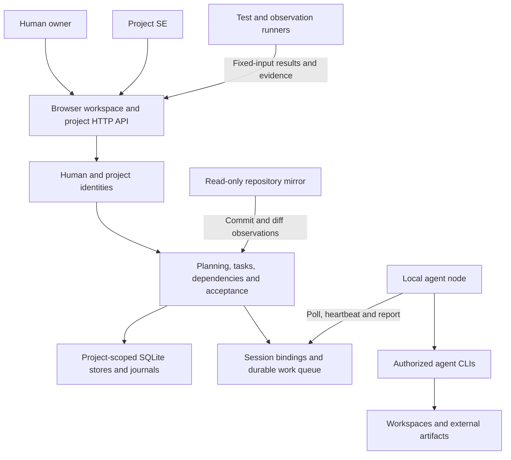

# WeftBoard

**Agentic Project Board**

**A self-hosted project control plane for human owners, software-engineering agents, and autonomous workers.**

English · [简体中文](README.zh-CN.md)

WeftBoard turns project intent into bounded parallel work and traceable delivery. A project SE defines goals, functional structure, tasks, interfaces, and acceptance criteria. Workers discover and claim ready tasks, raise questions without automatically stopping unrelated work, and submit outcomes with records and evidence. The SE reviews candidates and explicitly incorporates accepted work into the project baseline.

The board preserves project state across machines, agent products, models, and conversations. Its goal is less repeated coordination and more verifiable delivery.

Repository: [qzshch/weftboard](https://github.com/qzshch/weftboard).

## Goals

- Keep one authoritative record of scope, decisions, dependencies, candidates, acceptance, and baselines.
- Enable parallel work within explicit interfaces, write paths, and resource constraints.
- Separate delivery claims, reviews, code integration, and runtime verification.
- Support handoffs through versioned inputs, context packs, checkpoints, and native session IDs.
- Reuse reviewed practices and assets without silently changing consuming projects.
- Apply proportionate governance: a short path for ordinary tasks and stronger checks for higher-impact work.

## Architecture

The project SE is the coordinating role; an additional conversational main bot is optional. Unmanaged workers may join an open project and claim ready work. Managed sessions support dispatch and continuation through local adapters. Current node delivery is pull-based.

Execution machines retain their own CLI configuration, provider authentication, allowed roots, and local command policy. Repository tracking is read-only; agent-driven Git writes require separate authorization. Adapters exist for Codex, ZCode, DeepSeek Harness, and Antigravity CLI. Live validation varies by runtime and installed version.

Project identity and API isolation are not operating-system file isolation. Dedicated accounts or isolated environments are needed when stronger separation is required. Recording an external session ID does not grant control over that conversation.

## Information architecture

| Area | Main objects and views |
| --- | --- |
| Project workspace | Overview, current goals, project context, role-specific workbench |
| Product management | Requirements, confirmed definitions, changes, defects, business verification |
| Planning | Product stages, functional tree, engineering modules, research decisions, task dependencies |
| Delivery | Tasks, candidates, acceptance items, findings, rework, Git evidence, integration and runtime status |
| Quality | Versioned cases, suites, plans, fixed-input runs, environment and resource references |
| Collaboration | Comments, blockers, decisions, attempts, checkpoints, sessions, bounded delegation |
| Assets and knowledge | Resource locations, historical snapshots, reusable releases, pinned consumption and feedback |
| Analytics and administration | Work and waiting time, estimates, flow metrics, token observations, coverage, members and settings |

Functional hierarchy, hard dependencies, shared interfaces, output consumption, and exclusive resources have different meanings. Stage focus influences recommendations and delivery checks; it does not create artificial task dependencies.

## Design strengths

- **Project continuity:** scope, attempts, conversations, submissions, tests, and accepted baselines remain connected without becoming interchangeable facts.
- **Explicit parallel boundaries:** versioned interfaces, allowed paths, dependencies, and resources identify where workers can proceed independently.
- **Evidence-aware completion:** candidates can enter review early; final acceptance checks the applicable scope, evidence, tests, and repository anchors. Commit ancestry does not prove later code was tested.
- **Proportionate governance:** lightweight delivery, reviewed rules, batch operations, and bounded delegation reduce repeated approvals without permitting self-acceptance.
- **Practical storage boundaries:** source and authored fixtures belong in Git; raw research, large creative assets, caches, logs, test records, and runtime data stay in controlled external storage with discoverable references.
- **Honest accounting:** missing usage stays unknown. Observed tokens, imports, estimates, elapsed time, and declared effort are distinguished. Context-window occupancy is not token consumption.

These are design priorities, not benchmark claims against other platforms. Advantages should be evaluated with repeatable scenarios, coordination effort, rework, and recovery outcomes.

## Current status

Implemented areas include project-scoped agent access, human owner login, SE self-service project and node onboarding, worker self-claiming, asynchronous comments, candidate delivery, requirements and defects, stages and function trees, dependency exploration, structured acceptance, Git verification, rollback records, approved test execution, resource catalogs, versioned asset sharing, handoff packs, managed sessions, time metrics, and token observations.

The platform is evolving. Planning templates are not yet a general executable workflow engine. Transport acceptance is not business completion. Full workspace restoration, wider runtime metering, and sustained unattended operation need further implementation and validation. Optional mechanisms must not become mandatory steps for every project.

## Roadmap

The following are planned improvements, not completed-functionality claims. IDs provide stable references for discussion.

| Group | Planned work |
| --- | --- |
| Coordination · 01–06 | SE event-processing loop; business acknowledgements; notification batching; multi-SE ownership; deterministic rules; optional scheduled checks and escalation |
| Execution · 07–12 | Versioned executable workflows; correlated runs; structured outcomes; bounded repair; parallel joins; controlled pause, takeover and invalidation |
| Planning and briefs · 13–18 | Role packages; layered briefs; dispatch-context provenance; planning assistance; goal-to-verification coverage; delegation suggestions |
| Machines and workspaces · 19–24 | Onboarding diagnostics; workspace preparation; real checkpoints and restoration; environment profiles; compatibility and upgrade checks; test-instance visibility |
| Artifacts and delivery · 25–30 | Artifact contracts; single delivery-package ingestion; optional previews; authorized Git-write assistance; integration candidates; linked delivery anchors |
| Measurement and learning · 31–36 | More usage collectors; optional cost estimates; attributable phase timings; improvement drafts; measured comparisons; unified execution tracing |
| Product experience · 37–42 | SE actions in one workbench; execution monitoring; scenario-based onboarding; stage/tree adoption checks; shorter ordinary-task delivery; role-based versioned documentation |
| Reliability and interfaces · 43–48 | Lower snapshot amplification; realistic scale benchmarks; recovery drills; sustained-operation and fault tests; optional stronger isolation; typed SDK or MCP access |

The first focus is reliable SE event handling, concise briefs and delivery packages, actionable onboarding, fewer repeated operations, and reduced storage amplification.

## Repository guide

| Path | Purpose |
| --- | --- |
| `task_board/` | Storage, permissions, governance and HTTP services |
| `task_board_web/` | Browser workspace |
| `tools/` | Clients, runtime adapters, runners and verification |
| `templates/` | Request payloads and handoff templates |
| `tests/` | Authored regression tests and isolated fixtures |
| `docs/` | Operating guides, APIs and design boundaries |
| `design/` | UI references and prototypes |

Backend and local tools use Python 3.11+. Development checks: `python -B -X utf8 tools/run_checks.py`. Browser checks additionally require development dependencies and a supported browser. Results apply to the exact source and environment tested.

## Publication history

This history has been sanitized for public distribution. Original author and committer timestamps are preserved; they describe commit history, not the date this repository first became public. Deployment examples and contributor email addresses have been generalized.
