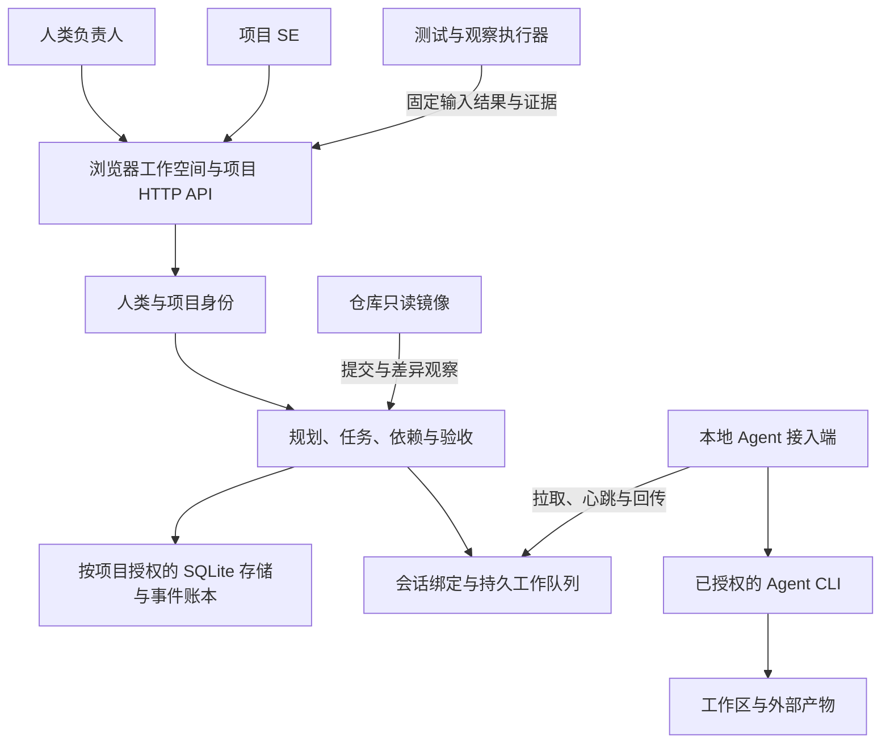

# Project Board · 项目公告板

**面向人类负责人、软件工程 SE Agent 和自主 Worker 的自托管项目控制面。**

[English](README.md) · 简体中文

Project Board 将项目意图转化为边界明确、可并行执行、可追溯验收的工作。项目 SE 制定目标、功能结构、任务、接口和验收标准；Worker 自行发现并认领就绪任务，在工作中提出问题，提交成果、工作记录、结论和证据；SE 复核候选，明确将已接受成果吸收入项目基线。

公告板保存跨机器、Agent 产品、模型和会话的项目状态，目标是减少重复协调，让项目边界和完成结论可以核验。

## 项目目标

- 为范围、决定、依赖、候选、验收和基线保留唯一权威记录。
- 让 Worker 在固定接口、写路径和资源约束内独立并行工作。
- 区分交付声明、审核结论、代码合入和运行验证。
- 通过固定输入、上下文包、检查点和原生 session ID 支持接手。
- 复用经过审核的实践和资产，消费项目不会被提供方更新自动改变。
- 按影响采用分级治理：普通任务走短流程，高影响任务采用更充分的核验。

## 系统架构

项目 SE 承担协调角色，无需额外增加一个对话 Main Bot。非托管 Worker 可以自行加入开放项目并领取就绪任务；受管会话通过本地适配器支持派发和接续。当前节点采用拉取式投递。

执行机器保留各自的 CLI 配置、供应商登录、允许目录和本地命令策略。仓库追踪器只读；Agent 执行 Git 写入仍须相应授权。目前已有 Codex、ZCode、DeepSeek Harness 和 Antigravity CLI 适配器，实机验证情况因运行时和安装版本而异。

项目身份和 API 隔离不等于操作系统文件隔离。需要更强边界时，应使用专用账户或隔离环境。登记外部 session ID，不等于取得该会话的控制权。

## 信息架构 IA

| 区域 | 主要对象与视图 |
| --- | --- |
| 项目工作空间 | 项目概览、当前目标、背景、按角色展示的工作台 |
| 产品管理 | 需求、已确认定义、变更、缺陷、业务验证 |
| 框架与规划 | 产品阶段、功能树、工程模块、调研决定、任务依赖 |
| 工程交付 | 任务、候选、验收项、发现、返修、Git 证据、合入和运行状态 |
| 测试与质量 | 版本化用例、套件、计划、固定输入运行、环境与资源引用 |
| Agent 协作 | 评论、阻塞、决定、尝试、检查点、会话、有界委派 |
| 资产与知识 | 资源入口、历史快照、复用版本、固定消费与反馈 |
| 分析与设置 | 投入与等待、估算、流动指标、Token 观察、覆盖率、成员和设置 |

功能层次、硬前置、共享接口、产物消费和排他资源分别建模。阶段聚焦影响推荐和交付核对，不产生人为的任务硬依赖。

## 设计优势

- **项目跨会话延续**：范围、尝试、会话、提交、测试和已接受基线相互关联，同时分别保留事实。
- **并行边界明确**：版本化接口、允许路径、依赖和资源约束，明确哪些工作可以独立推进。
- **完成结论有证据**：候选可先进入待审队列；正式验收仍核对范围、证据、测试和仓库锚点。提交祖先关系不能证明后续代码已通过测试。
- **治理按需裁剪**：轻量交付、已审核规则、批量操作和有界委派减少重复审批，同时禁止执行者自行验收成果。
- **存储适配真实项目**：源码和刻意编写的 fixture 进入 Git；原始调研、大型创作资产、缓存、日志、测试记录和运行态留在受控外部存储，项目内保留可发现的入口。
- **统计口径真实**：未采集保持未知；实测 Token、导入、估算、自然历时和显式投入分别展示，不把上下文占用误报为 Token 消耗。

以上是设计取向，不构成优于其他平台的性能结论。实际优势需通过可重复的项目场景、协调成本、返工和恢复结果验证。

## 当前状态

已有能力包括项目 Agent 权限、人类负责人登录、SE 自助开项目和接入节点、Worker 自助认领、异步评论、候选交付、需求与缺陷、阶段和功能树、依赖探索、结构化验收、Git 核验、回退记录、已批准测试执行、资源目录、版本化资产共享、接手包、受管会话、时间指标和 Token 观察。

平台仍在演进。规划模板尚不等于通用可执行流程引擎；传输接收不等于业务处理完成。完整工作区恢复、更广泛的运行时用量采集及持续无人值守运行，仍需进一步实现和验证。按需机制不应成为每个项目的必填步骤。

## 当前待办 Roadmap

以下是计划改进，不是已经完成的功能声明。编号用于稳定引用和讨论。

| 分组 | 待办 |
| --- | --- |
| 协作调度 · 01–06 | SE 事件处理闭环、业务回执、通知合并、多 SE 主责、确定性规则、按需定期巡检与升级提醒 |
| 执行流程 · 07–12 | 版本化可执行流程、关联运行、结构化结果、有界返修、并行汇合、受控暂停／接管／失效处理 |
| 规划与任务书 · 13–18 | 专业角色包、分层 brief、派发上下文留痕、规划辅助、目标与验证覆盖、委派建议 |
| 机器与工作区 · 19–24 | 接入诊断、工作区准备、真实快照与恢复、环境配置、兼容与升级、测试实例可见性 |
| 产物与交付 · 25–30 | 产物契约、一次交付包登记、按需预览、获授权的 Git 写入辅助、集成候选、交付锚点关联 |
| 统计与学习 · 31–36 | 更多用量采集器、按需费用测算、可归因的阶段计时、改进草案、前后效果对比、统一执行追踪 |
| 产品体验 · 37–42 | 工作台完成 SE 主要操作、运行监视、场景化接入、阶段和功能树采用核对、普通任务短流程、按角色和版本收敛手册 |
| 可靠性与接口 · 43–48 | 降低快照放大、真实规模基准、完整恢复演练、持续运行与故障验证、按需更强隔离、类型化 SDK 或 MCP 入口 |

优先改善可靠的 SE 事件处理、简明任务书与一次交付、可操作的接入诊断、重复操作及状态存储放大。

## 仓库导航

| 路径 | 用途 |
| --- | --- |
| `task_board/` | 存储、权限、治理和 HTTP 服务 |
| `task_board_web/` | 浏览器工作空间 |
| `tools/` | 客户端、运行时适配、执行器和验证工具 |
| `templates/` | 请求载荷与交接模板 |
| `tests/` | 测试代码与独立 fixture |
| `docs/` | 操作指南、API 和设计边界 |
| `design/` | 界面设计参考与原型 |

后端与本地工具使用 Python 3.11+。开发检查命令为 `python -B -X utf8 tools/run_checks.py`；浏览器验证还需开发依赖和受支持浏览器。测试结论只适用于产生它的准确源码和环境。

## 公开历史说明

本仓库历史已为公开分发进行脱敏。保留的原始作者和提交者时间表示提交历史，不代表仓库首次公开的日期。部署示例和贡献者邮箱已通用化处理。
